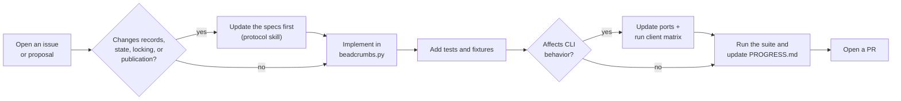

# Contributing to Beadcrumbs

Thanks for your interest! Beadcrumbs is small on purpose, so the most valuable contributions are usually **sharper specs, more conformance cases, and platform verification** rather than new features.

## Ground rules

These are the project's hard constraints. Changes that break them won't be merged.

1. **`beadcrumbs.py` stays a single file** that runs on **Python 3.10+** using **only the standard library**.
2. **Offline, filesystem-only.** No network calls, telemetry, subprocesses, databases, daemons, or Git dependency at runtime, in any client.
3. **The specs are the contract.** [Core contract](docs/core-contract.md), [CLI](docs/cli.md), [protocol](docs/protocol.md), and [concurrency](docs/concurrency.md) define behavior. Python is the reference implementation, not the specification.
4. **Respect the [implementation boundaries](docs/implementation-boundaries.md):** codec, logical validation and lifecycle, centralized publication, and pure presentation.

## Ways to help

| Area | Examples |
| --- | --- |
| 🧪 **Verification** | Run the suites on Linux, Windows, Python 3.10, Node 22, Go 1.22, or Rust 1.85 and report results. |
| 📜 **Spec review** | Find ambiguities or contradictions between the spec documents. |
| 🧩 **Conformance cases** | Add fixtures to `tests/fixtures/cases.json` for edge cases that aren't covered yet. |
| 🐛 **Bug fixes** | Especially divergence between clients. |
| 📚 **Docs** | Tutorials, examples, and agent recipes. |
| 💡 **Features** | Start with a proposal; see [below](#proposing-a-feature). |

## Development setup

No setup is needed for the reference client:

```sh
git clone https://github.com/Frankiey/beadcrumbs.git && cd beadcrumbs
python3 beadcrumbs.py --help
python3 -m unittest discover -s tests -v
```

Each port has its own build guide under [`implementations/`](implementations/README.md). All builds work offline once toolchains and locked dependencies are present.

### Make targets

The [Makefile](Makefile) holds the commands CI runs, so a green `make check` locally should mean a green pull request. Run `make` to list every target.

| Command | What it does |
| --- | --- |
| `make check` | Lint, test, and check docs for all five clients |
| `make lint` / `make fmt` | Check formatting and lint, or fix formatting in place |
| `make test` | Run each client's own test suite |
| `make matrix` | Build every client, then run the shared CLI suite for each and every client pair |
| `make docs` | Check Markdown links and anchors, and that schemas and fixtures parse |
| `make py-test`, `make go-lint`, … | Run one step for one client |

Python linting uses [Ruff](https://docs.astral.sh/ruff/) pinned in the Makefile, run through `uvx` when it is installed. Ruff is a development tool only; `beadcrumbs.py` stays dependency-free. Rust and npm commands default to `--offline`. Pass `CARGO_NET= NPM_NET=` to let them fetch locked dependencies.

## Repository layout

```text
beadcrumbs.py              # Python reference client (single file)
docs/                      # Specs, guides, ADRs, research
schemas/v1/                # JSON Schemas for manifest, issues, results
tests/
  test_cli.py              # Black-box CLI suite (works against any client)
  test_interop.py          # Pairwise client interoperability
  test_storage.py          # Reference-only fault injection
  fixtures/cases.json      # Shared deterministic scenarios
tools/check_docs.py        # Link, anchor, and JSON checks (make docs)
Makefile, ruff.toml        # Local commands and lint settings shared with CI
.github/workflows/ci.yml   # Pull request checks
integration/
  run.py                   # Persistent lifecycle example
  test_clients.py          # 5-client × 10-pair matrix
implementations/           # Go, Rust, .NET, TypeScript clients (python/ points to the root file)
.agents/skills/            # Agent skill for protocol-affecting changes
AGENTS.md, PROGRESS.md     # Instructions and handoff log for coding agents
```

## Making a change



`main` is protected: every change, including the maintainer's, lands through a pull request. A review from the maintainer is requested automatically through [CODEOWNERS](.github/CODEOWNERS), and one approval with all conversations resolved is required before merging. The "CI passed" check must also be green.

### Protocol-affecting changes

If your change touches store records, issue state, claim tokens, locking, or atomic publication, follow the [Beadcrumbs protocol skill](.agents/skills/beadcrumbs-protocol/SKILL.md):

- Check current state **under the lock**, publish **at most one** authoritative record, and leave the prior record intact on failure.
- Test against an existing store **and** a second concurrent process.
- For claim changes, test contention and a stale token.
- For format changes, check that unsupported versions are rejected **before** any lock or scratch file is created.
- Update the affected spec and examples in the same change. After v1 freezes, follow the versioning rules.

### CLI changes

Keep the semantics of JSON output and exit codes identical across clients. Update [docs/cli.md](docs/cli.md) and, where relevant, `schemas/v1/results.schema.json`. Then build the ports and run:

```sh
python3 integration/test_clients.py
```

## Testing checklist

Before opening a pull request:

- [ ] `make check` passes, or at least `make py-lint py-test` for Python-only changes.
- [ ] New behavior has a test. Tests that create tracker data use **temporary workspaces**.
- [ ] Specs and examples are updated when behavior changes.
- [ ] `beadcrumbs.py` still imports only standard-library modules.
- [ ] If ports are affected, `make matrix` passes or the PR says which clients still need updating.
- [ ] [CHANGELOG.md](CHANGELOG.md) has an entry under Unreleased for user-visible changes.
- [ ] [PROGRESS.md](PROGRESS.md) records what was done and how it was verified.

## Proposing a feature

Read [features.md](docs/features.md) first, since many ideas are already listed as **Next** or **Later**. A good proposal includes:

1. The concrete agent workflow it unblocks.
2. Acceptance criteria you could test.
3. Its effect on the protocol: new fields, new commands, or new coordination rules.
4. How it behaves under contention and after an interrupted write.

Significant design decisions get an [ADR](docs/adr/README.md).

## Reporting issues

Please include:

- the client and version (`--version`), OS, filesystem, and runtime or toolchain version
- the exact command(s) and exit code
- stderr output
- if you can share it, a minimal store that reproduces the problem (remove sensitive text first)

For suspected security issues, such as path handling or symlink and reparse-point escapes, follow [SECURITY.md](SECURITY.md) instead of opening a public issue.

## Style

- Python: standard library only, type-friendly, small functions.
- Docs: short sentences, present tense, and RFC 2119 words (MUST, SHOULD) only in normative specs. Diagrams use Mermaid so they render on GitHub.
- Formatting follows [`.editorconfig`](.editorconfig).

## License

Beadcrumbs is licensed under the [Apache License 2.0](LICENSE). Under section 5 of that license, any contribution you intentionally submit is licensed under the same terms unless you explicitly state otherwise. New source files should start with:

```text
SPDX-License-Identifier: Apache-2.0
```

Use the comment syntax of the file's language.

## Working with coding agents

Agents contributing to this repository should read [AGENTS.md](AGENTS.md) and [PROGRESS.md](PROGRESS.md) first, and update PROGRESS.md before handing off.
