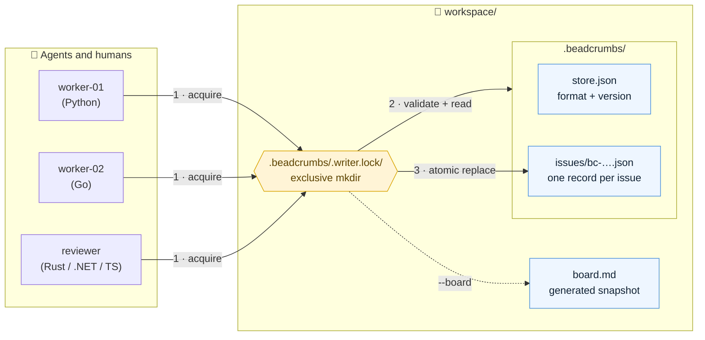
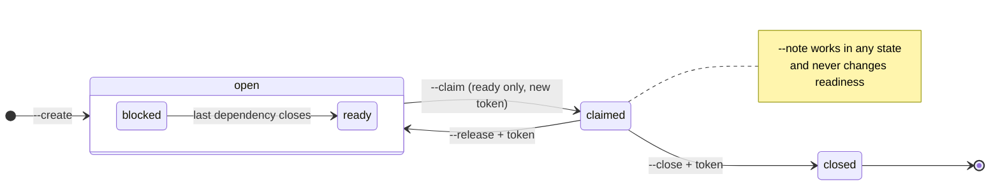
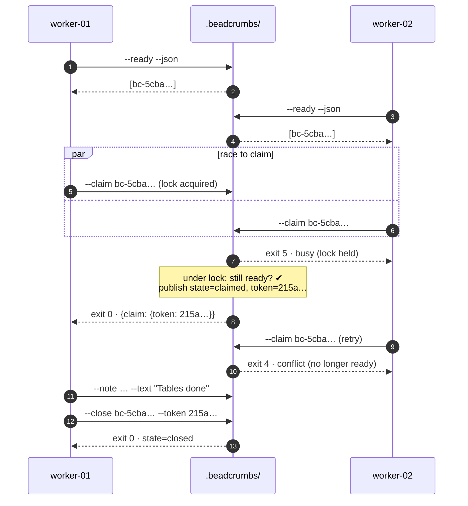
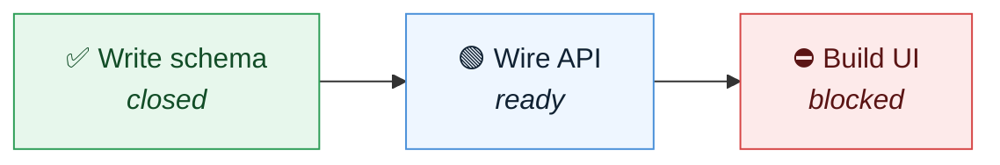
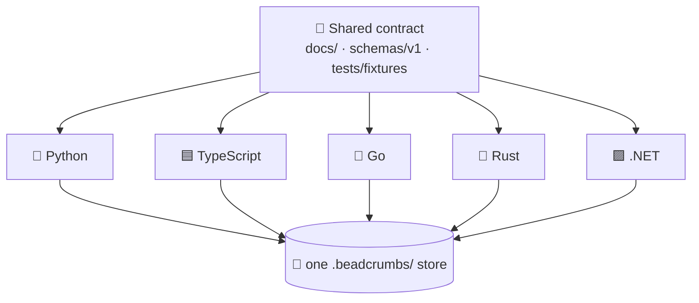

<div align="center">

# 🍞 Beadcrumbs

**A tiny, filesystem-native issue tracker for coding agents.**<br>
Find ready work, claim it, leave a trail of notes, close it. Offline. One file. Zero dependencies.

[](#-quick-start)
[](#-why-beadcrumbs)
[](docs/security.md)
[](docs/core-contract.md)
[](LICENSE)
[](implementations/README.md)

[Quick start](#-quick-start) ·
[How it works](#-how-it-works) ·
[Agent workflow](#-the-agent-loop) ·
[Docs](docs/README.md) ·
[Contributing](CONTRIBUTING.md)

</div>

---

Beadcrumbs gives a team of coding agents (and the humans supervising them) a shared to-do list that lives **inside the workspace as plain JSON files**. There is no server, no database, no daemon, and no Git requirement. Copy `beadcrumbs.py` into an air-gapped box, run `--init`, and your agents can coordinate.

```console
$ python3 beadcrumbs.py --init
$ python3 beadcrumbs.py --create "Write schema" --acceptance-criteria "Migration applies cleanly"
$ python3 beadcrumbs.py --ready --json        # what can I work on?
$ python3 beadcrumbs.py --claim bc-5cba… --agent worker-01
$ python3 beadcrumbs.py --note  bc-5cba… --agent worker-01 --text "Tables done, testing migration"
$ python3 beadcrumbs.py --close bc-5cba… --token 215a…
```

## ✨ Why Beadcrumbs?

| | |
| --- | --- |
| 📦 **One file, stdlib only** | The reference client is a single `beadcrumbs.py` for Python 3.10+. No `pip install`, no virtualenv. |
| ✈️ **Air-gap friendly** | No network calls, telemetry, subprocesses, or Git operations. It needs only a writable local directory. |
| 🔒 **Race-safe claims** | Every operation runs under one store lock. Two agents racing for the same issue: exactly one wins. |
| 🎟️ **Stale-proof assignments** | Each claim mints a fresh token. A worker that wakes up late cannot close someone else's newer claim. |
| 🧱 **Dependency-aware** | Issues can block on other issues. `--ready` shows only unblocked work; `--blocked` explains why. |
| 💥 **Crash-consistent** | Records are published by atomic replace. Interrupt a write at any point and readers see the old record or the new one, never half a file. |
| 👀 **Human-readable** | One pretty-printed JSON file per issue, plus a generated Markdown `board.md` for a quick overview. |
| 🌐 **Polyglot by design** | Independent Go, Rust, .NET, and TypeScript clients share the same store and pass a cross-client conformance matrix. |

## 🚀 Quick start

**Requirements:** Python 3.10 or later. That's it.

```sh
# Grab the single file (or just copy it from this repository)
cp beadcrumbs.py /path/to/your/project/
cd /path/to/your/project

python3 beadcrumbs.py --init                         # create .beadcrumbs/
python3 beadcrumbs.py --create "Document the offline setup"
python3 beadcrumbs.py --ready                        # list unblocked work
python3 beadcrumbs.py --board                        # write board.md
```

Every store action accepts `--workspace PATH` (defaults to the current directory) and `--json` for compact machine output. New to the tool? Follow the **[10-minute tutorial](docs/getting-started.md)**.

## 🧭 How it works

All clients talk to the same directory. There's no process to coordinate through, just files, one exclusive lock directory, and atomic renames.



1. **Lock.** Every command, including reads, creates `.beadcrumbs/.writer.lock/` with an exclusive `mkdir`. If it already exists, the command exits `5` (busy) right away, and callers retry with backoff.
2. **Validate.** Under the lock, the client loads every issue and checks the whole store: schemas, the dependency graph, cycles, and filenames. A corrupt store stops all operations instead of being silently "fixed".
3. **Publish.** A mutation writes a complete new record to a scratch file, `fsync`s it, and atomically renames it over the old one. The rename is the commit point.

The layout on disk is deliberately boring:

```text
<workspace>/
├── board.md                         # optional, generated by --board
└── .beadcrumbs/
    ├── store.json                   # {"format": "beadcrumbs", "version": 1}
    └── issues/
        ├── bc-5cba71133efc4e308ab5d490eec20268.json
        └── bc-dd1c3002451d4743aef78e6e6333d980.json
```

## 🔄 Issue lifecycle

An issue has exactly one stored state. **Ready** and **blocked** are views derived from an open issue's dependencies.



| Command | Precondition | Effect |
| --- | --- | --- |
| `--create TITLE` | Every `--depends-on` ID exists | New `open` issue, revision 1 |
| `--claim ID --agent LABEL` | Issue is open and every dependency is closed | `claimed`, new agent/token pair |
| `--note ID --agent LABEL --text TEXT` | Issue exists | Appends an attributed, timestamped note |
| `--release ID --token TOKEN` | Claimed and token matches | Back to `open` |
| `--close ID --token TOKEN` | Claimed and token matches | `closed` (terminal) |

Dependencies are fixed at creation and closed issues stay closed. That rules out cycles from the CLI and keeps the model easy to reason about.

## 🤖 The agent loop

Beadcrumbs is designed for many short-lived agent processes that may race, crash, or resume. Here's what happens when two of them want the same issue:



A `--ready` list is only a snapshot. Eligibility is checked again under the lock at claim time, so agents never have to trust a stale listing. Exit codes are the machine-readable contract:

| Exit | Meaning | What an agent should do |
| :---: | --- | --- |
| `0` | Success, including an empty ready list | Continue |
| `1` | I/O error, missing or invalid store, unsupported version | Stop and escalate to a human |
| `2` | Invalid invocation | Fix the command |
| `3` | Issue not found | Refresh with `--list` |
| `4` | State conflict or token mismatch | Pick different work |
| `5` | Lock busy | Retry with bounded backoff |

See the **[agent integration guide](docs/agent-guide.md)** for a drop-in `AGENTS.md` snippet, a retry wrapper, and crash-recovery recipes.

## 🧩 Dependencies in practice

```sh
SCHEMA=$(python3 beadcrumbs.py --create "Write schema" --json | jq -r .id)
API=$(python3 beadcrumbs.py --create "Wire API" --depends-on "$SCHEMA" --json | jq -r .id)
UI=$(python3 beadcrumbs.py --create "Build UI" --depends-on "$API" --json | jq -r .id)

python3 beadcrumbs.py --blocked --json   # "Wire API" is blocked by an open "Write schema" …
```



`--blocked` names each unresolved direct blocker and its state, so an agent (or a human) can see *why* work isn't available yet.

## 📋 Markdown board

```sh
python3 beadcrumbs.py --board
```

This writes `board.md` in the workspace: a timestamped snapshot with **Ready**, **Blocked**, **Claimed**, and **Closed** sections. Claim tokens and notes are left out, which makes it suitable for pasting into a PR or chat. It is regenerated on demand, published atomically, and never read back as state.

```markdown
## Ready (1)

| ID | Title | Agent | Blockers |
| --- | --- | --- | --- |
| bc-dd1c3002451d4743aef78e6e6333d980 | Wire API | — | — |
```

## 🌐 Implementations

Five independent clients share one protocol. None of them shells out to another, and all of them pass the same black-box CLI suite plus pairwise interoperability tests (**130/130 passing** on macOS).

| Client | Location | Runtime |
| --- | --- | --- |
| 🐍 **Python** (reference) | [`beadcrumbs.py`](beadcrumbs.py) | Python 3.10+ standard library |
| 🟦 **TypeScript / npm** | [`implementations/javascript`](implementations/javascript/README.md) | Node 22+, no runtime npm deps |
| 🐹 **Go** | [`implementations/go`](implementations/go/README.md) | Native binary, stdlib only |
| 🦀 **Rust** | [`implementations/rust`](implementations/rust/README.md) | Native binary |
| 🟪 **.NET** | [`implementations/dotnet`](implementations/dotnet/README.md) | .NET 11, no NuGet packages |



Want to write a sixth client? Start with the [core contract](docs/core-contract.md), the [protocol](docs/protocol.md), and the [implementation boundaries](docs/implementation-boundaries.md), then point the conformance suite at your binary:

```sh
BEADCRUMBS_COMMAND='["/abs/path/to/your-client"]' \
  python3 -m unittest discover -s tests -p test_cli.py -v
```

## 🧪 Testing

```sh
python3 -m unittest discover -s tests -v   # reference suite, no external packages
python3 integration/run.py                 # persistent, checked lifecycle demo
python3 integration/run.py --setup-only    # leave a workspace to explore by hand
python3 integration/test_clients.py        # full 5-client × 10-pair matrix (after building ports)
```

The suites cover competing claims across processes, stale tokens, simultaneous init, process death immediately before and after the atomic rename, `fsync` and replace failures, corrupt stores (duplicate keys, invalid Unicode, cycles, FIFOs), and a full lifecycle under an audit hook that rejects any network or subprocess call. Details are in [conformance](docs/conformance.md).

## 🆚 How does it compare?

| | Beadcrumbs | [Beads](https://github.com/gastownhall/beads) | GitHub Issues | `TODO.md` |
| --- | :---: | :---: | :---: | :---: |
| Works fully offline / air-gapped | ✅ | ✅ (embedded Dolt) | ❌ | ✅ |
| Nothing to install (single stdlib file) | ✅ | ❌ (`bd` binary) | n/a | ✅ |
| Plain files you can `cat` and `grep` | ✅ JSON | ⚠️ Dolt DB + JSONL export | ❌ | ✅ |
| Atomic, race-safe claims | ✅ | ✅ | ❌ | ❌ |
| Dependency-aware ready list | ✅ | ✅ | ⚠️ | ❌ |
| Priorities, labels, epics | ❌ (priority planned) | ✅ | ✅ | ❌ |
| Multi-machine sync | ❌ (out of scope for v1) | ✅ (Dolt remotes) | ✅ | ⚠️ via Git |

Beadcrumbs grew out of a [feature review of Beads](docs/research/beads-feature-extraction.md). The Beads column reflects commit `53cc7d8` (November 2026). It trades Beads' richer feature set for the smallest possible deployment footprint and a plain-file protocol that any language can implement.

## 📚 Documentation

| Guides | Specifications | Background |
| --- | --- | --- |
| [Getting started](docs/getting-started.md) | [Core contract](docs/core-contract.md) | [Architecture](docs/architecture.md) |
| [Agent integration](docs/agent-guide.md) | [CLI reference](docs/cli.md) | [Decision records](docs/adr/README.md) |
| [FAQ & troubleshooting](docs/faq.md) | [On-disk protocol](docs/protocol.md) | [Feature proposals](docs/features.md) |
| [Integration example](integration/README.md) | [Concurrency & atomicity](docs/concurrency.md) | [Roadmap](docs/roadmap.md) |
| [Building the ports](implementations/README.md) | [Security model](docs/security.md) | [Progress log](PROGRESS.md) |

The full map is in the **[documentation index](docs/README.md)**.

## 🗺️ Roadmap

- [x] Core v1 draft lifecycle: init, create, show, list, ready, blocked, claim, note, release, close, validate
- [x] Atomic publication and crash-interruption tests
- [x] Markdown board
- [x] Go, Rust, .NET, and TypeScript clients with a cross-client conformance matrix
- [ ] Linux and Windows verification, plus minimum-toolchain checks
- [ ] Freeze protocol v1
- [ ] `claim-next`, priority, editable task content, session context command
- [ ] Packaged releases

See the [roadmap](docs/roadmap.md) and [feature proposals](docs/features.md) for details.

## ⚠️ Status and limits

Beadcrumbs is **pre-release**. The protocol is *v1 draft 1* and may change before it freezes. By design, v1:

- coordinates cooperating processes on **one machine and one local filesystem**. Network shares and synced copies are not validated.
- has **no automatic lock or claim expiry**. Recovery is an explicit operator step ([how](docs/faq.md#a-worker-crashed-while-holding-a-claim)).
- guarantees atomicity under **process interruption**, not power loss.
- treats the workspace as **trusted**. Agent labels are attribution, not authentication ([threat model](docs/security.md), [reporting vulnerabilities](SECURITY.md)).

## 🤝 Contributing

Contributions are welcome. Please read **[CONTRIBUTING.md](CONTRIBUTING.md)** first. The short version:

- Keep `beadcrumbs.py` a single, stdlib-only, Python 3.10+ file.
- Changes to records, locking, or publication must update the specs and follow the [protocol skill](.agents/skills/beadcrumbs-protocol/SKILL.md).
- Run `python3 -m unittest discover -s tests -v` before sending a change.

Coding agents working in this repository should start with [AGENTS.md](AGENTS.md) and [PROGRESS.md](PROGRESS.md).

## 📄 License

Beadcrumbs is licensed under the [Apache License 2.0](LICENSE). That covers the reference client, every language port, the specifications, and the schemas. Copying `beadcrumbs.py` into your own workspace is fine. If you redistribute it to others, include a copy of the license, as section 4 requires.

<div align="center">
<sub>Leave a trail. Pick up where the last agent left off. 🍞</sub>
</div>
