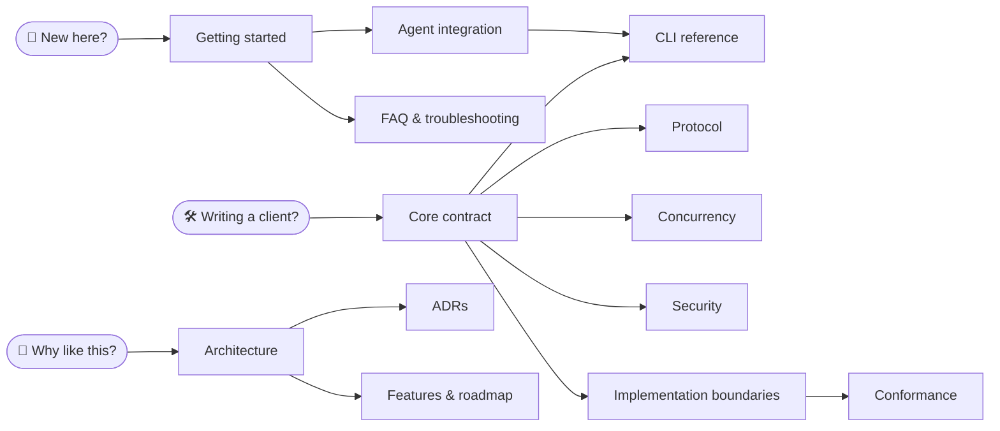

# Beadcrumbs documentation

Welcome! These docs are split into **guides** (learn and use), **specifications** (the normative contract every client must follow), and **background** (why things are the way they are).

## 📘 Guides

| Document | Read it when you want to… |
| --- | --- |
| [Getting started](getting-started.md) | Run the full lifecycle in 10 minutes, from `--init` to `--board`. |
| [Agent integration](agent-guide.md) | Teach a coding agent to use Beadcrumbs: an `AGENTS.md` snippet, retry logic, and crash recovery. |
| [FAQ & troubleshooting](faq.md) | Fix "lock is busy", recover a dead worker, use Git, or understand an error. |
| [Integration example](../integration/README.md) | Generate a realistic workspace to poke at, with a full command transcript. |
| [Building the ports](../implementations/README.md) | Build and test the Go, Rust, .NET, and TypeScript clients. |

## 📜 Specifications (normative)

These documents form the v1 draft 1 contract. If two of them disagree, that is a spec bug. Please [open an issue](../CONTRIBUTING.md#reporting-issues).

| Document | Defines |
| --- | --- |
| [Core contract](core-contract.md) | Scope, capabilities, state machine, failure semantics, and the conformance scenarios. **Start here.** |
| [CLI](cli.md) | Actions, options, JSON output shapes, exit codes, and error precedence. |
| [On-disk protocol](protocol.md) | `store.json`, issue records, IDs, timestamps, and validation rules. |
| [Concurrency & atomicity](concurrency.md) | The lock, initialization, atomic publication, and manual recovery. |
| [Security & threat model](security.md) | The trust boundary, path checks, untrusted text, and Git data handling. |
| [Implementation boundaries](implementation-boundaries.md) | The codec, validation, publication, and rendering layering every client must keep. |
| [Conformance](conformance.md) | Shared fixtures, JSON Schemas, and how to run the suites against any client. |
| [JSON Schemas](../schemas/v1/) | Machine-readable structure for manifests, issues, and command results. |

## 🧠 Background

| Document | Covers |
| --- | --- |
| [Architecture](architecture.md) | Workspace selection, storage layout, and the lifecycle at a glance. |
| [Architecture decision records](adr/README.md) | Why the filesystem is the interface, why there is one lock, and why claims are explicit. |
| [Feature proposals](features.md) | What's in v1, what's next, and the open questions. |
| [Roadmap](roadmap.md) | Release milestones. |
| [Beads feature extraction](research/beads-feature-extraction.md) | The source review that shaped the feature set. |
| [Progress log](../PROGRESS.md) | Current verification evidence and remaining work. |

## Glossary

| Term | Meaning |
| --- | --- |
| **Workspace** | The directory selected with `--workspace` (default: the current directory). It contains `.beadcrumbs/`. Parent directories are never searched. |
| **Store** | `.beadcrumbs/`: a manifest (`store.json`) plus one JSON file per issue under `issues/`. |
| **Ready** | An `open` issue whose direct dependencies are all `closed`. This view is derived, not stored. |
| **Blocked** | An `open` issue with at least one dependency that is `open` or `claimed`. This view is derived, not stored. |
| **Claim token** | A fresh random value issued by each successful `--claim`, required to `--release` or `--close` that specific claim. |
| **Agent label** | A caller-supplied name such as `worker-01` used for attribution. It is not authentication. |
| **Revision** | A per-issue counter that starts at 1 and increments by one on every mutation. |
| **Writer lock** | The transient directory `.beadcrumbs/.writer.lock/`, created exclusively by every command. |
| **Publication** | Writing a scratch file, flushing it, then atomically renaming it over the destination. The rename is the commit point. |
| **Codec** | The layer that turns logical issue records into bytes and back. v1 uses `JsonIssueCodec`. |
