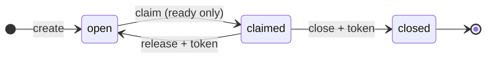
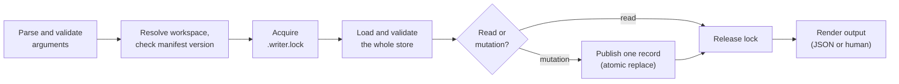

# Architecture

A Beadcrumbs workspace is a directory selected by the caller. It can be a source checkout or a standalone directory. Each invocation acts on the current working directory or the exact directory supplied by `--workspace PATH`. Clients do not search parent directories. An absent store requires explicit initialization.

```text
<workspace>/
  .beadcrumbs/
    store.json
    issues/
      bc-3a3d0744c20a4f35814eb2fc71629888.json
    .writer.lock/                       # transient
```

`store.json` identifies the protocol version. Each issue file is authoritative for one issue and its progress notes. Ready lists are derived by scanning the issue directory. A store has no required cache or index. A human can inspect the files with ordinary tools, and an independently implemented client can use the same store by following the [protocol](protocol.md) and [locking rules](concurrency.md).

## Lifecycle



| State | Meaning | Next state |
| --- | --- | --- |
| `open` | Unclaimed. Ready when every dependency is closed. | `claimed` |
| `claimed` | Assigned to a worker. The current claim token identifies this assignment. | `open` on release, `closed` on completion |
| `closed` | Completed. Satisfies dependencies. | Terminal |

Create an issue with optional dependencies on existing issue IDs. Dependencies are immutable after creation. The v1 CLI has no delete or reopen operation, so a successful claim stays eligible until its owner releases or closes it. Notes can be appended in any state and have no effect on readiness.

A worker lists ready issues, then attempts to claim one. Another worker may take it between those calls. A successful claim returns a token that the worker supplies when releasing or closing that particular claim. Claims have no expiry. The [recovery procedure](concurrency.md#recovering-an-abandoned-claim) covers interrupted workers.

## Command flow

Every store command, read or write, follows the same path. Output is rendered only after the lock is released.



## Scope

The first implementation targets cooperating processes on one machine using a local filesystem. Store operations serialize through one lock and mutate at most one issue record per command. Full scans and a growing notes array are deliberate trade-offs for small stores. Distributed coordination, batch transactions, mutable dependency graphs, sync, and a separate event log are outside draft v1.

## Implementation organization

For a guided tour of all documents, see the [documentation index](README.md).

[Implementation boundaries](implementation-boundaries.md) define serialization, logical state, file publication, and presentation responsibilities. The [language package layout](../implementations/README.md) places the additional clients under implementations/ while retaining the root Python entry point.
