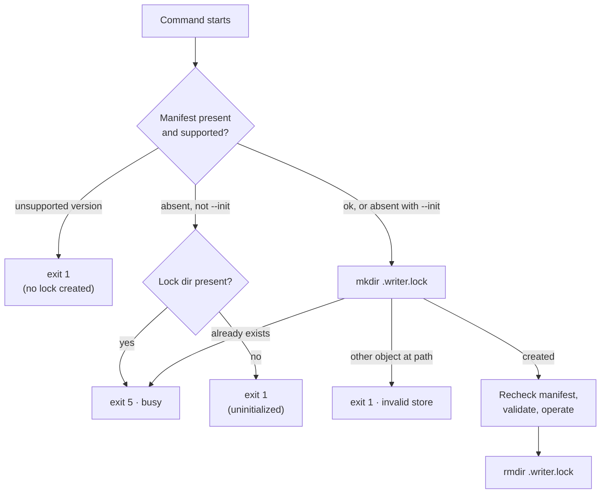
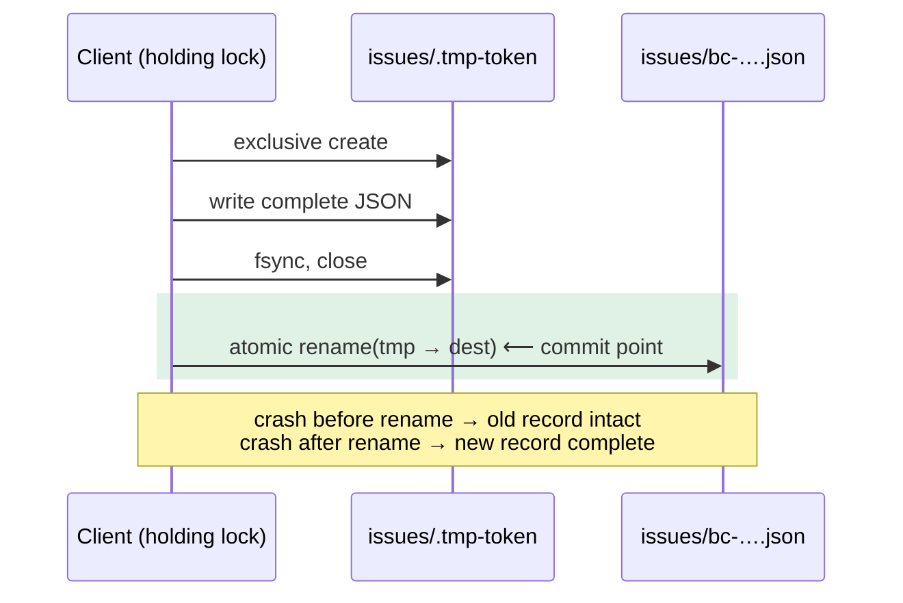

# Concurrency and atomicity

Draft v1 coordinates cooperating processes on the same machine and the same physical store. A supported filesystem must provide atomic exclusive directory creation and atomic same-directory replacement. Each client must be able to report an error if its publication primitive fails. Network shares and independently synchronized copies require separate validation before they can be supported.

## Locking

1. Resolve the exact workspace and check store paths. If the store root is absent, only `--init` may create it. Read any existing manifest and reject unsupported versions before acquiring the lock. When the manifest is absent, `--init` may proceed to lock acquisition. Other actions return busy if an ordinary lock directory is present. If no lock is present, check the manifest again before reporting an uninitialized store, since initialization may have just finished. An unexpected object at the lock path is an invalid store.
2. Attempt one exclusive directory creation at `.beadcrumbs/.writer.lock`. An existing ordinary lock directory returns busy immediately. Any other object at that path is an invalid store. Never adopt a lock directory created by another invocation.
3. Under the lock, recheck the manifest, load and validate the required state, and perform the operation. Both readers and writers take the lock so a scan sees a consistent store. Render output from the captured result after releasing the lock.
4. Remove the empty lock directory when the operation completes or fails normally. If unlocking fails, report an I/O error. Any record already published remains visible.

Callers can retry busy results with bounded backoff. `--ready` is a snapshot, while `--claim` checks readiness again under the lock. Release and close check the claim token against the current record under the same lock that guards publication. This prevents a previous holder from closing or releasing a newer claim.

## Initialization

Require the selected workspace to exist. Create `.beadcrumbs/` if needed and acquire its lock before creating any other store entries. Under the lock, accept a missing manifest only when the store root contains the lock, an optional empty ordinary `issues/` directory, and optional regular files named `.tmp-<token>` using the token syntax in the [protocol](protocol.md#issue-record). Leave any other uninitialized contents intact and report an error. Create `issues/` if absent, then publish the manifest last. An existing v1 store must pass validation before `--init` reports success.

## Publishing a record

1. Under the lock, build and validate the complete next record. Create a fresh scratch file exclusively beside the destination using `.tmp-<token>`. Apply the permissions described in [Security](security.md#workspace-boundary).
2. Write the complete UTF-8 JSON payload, flush it through the file synchronization primitive, then close the file.
3. Atomically replace the destination using the platform's same-directory rename or replace primitive. For issue creation, verify the destination is absent under the lock before publication. The rename is the commit point.
4. Remove unpublished scratch files on normal failure. Leftover scratch files are ignored by issue scans. They can be removed during maintenance after all clients have stopped.

A process that stops before publication leaves the previous record or an absent destination. After publication, readers see the complete replacement. An abrupt stop can leave a lock or scratch file. v1 does not require directory synchronization and makes no power-loss durability guarantee. A backup must be taken while clients are stopped or with a storage snapshot that preserves a coherent store.

## Recovering an abandoned lock

Stop all clients and prevent them from starting against the store. Inspect the lock path and confirm it is an empty ordinary directory. Remove that directory, then validate the store before resuming work. If the interrupted operation was initial setup and the manifest is absent, rerun `--init` after unlocking. There is no automatic stale-lock removal. A timestamp or process ID cannot establish exclusive ownership reliably.

## Recovering an abandoned claim

Once the original worker has stopped, use `--show ID --json` to read the current claim token, then pass it to `--release`. A concurrent change of claim results in a token mismatch. Recovery relies on workspace access and operator judgment.

## Board publication

The --board command holds the store lock while reading and atomically replacing the derived workspace-level board.md. It uses the same exclusive scratch creation, flush, and replacement primitive as issue writes. Scratch files for this operation live beside board.md. A stopped process may leave a workspace-level .tmp-<token> file and the store lock. Remove leftover scratch files during maintenance with all clients stopped. The board is a replaceable snapshot and is never read as issue state.
