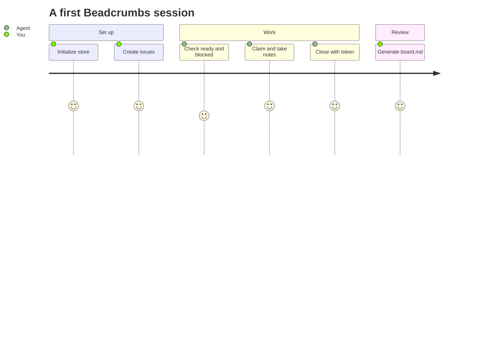

# Getting started

This tutorial walks through the full Beadcrumbs lifecycle in a scratch directory. It takes about 10 minutes and needs only Python 3.10 or later.

You will:

1. Create a store.
2. Add two issues, one depending on the other.
3. See why one is blocked.
4. Claim, annotate, and close the first issue.
5. Watch the second one become ready.
6. Generate a Markdown board.



> **Tip:** The examples use `jq` to pull values out of JSON. If you don't have it, substitute `python3 -c 'import json,sys; print(json.load(sys.stdin)["id"])'` or copy the value by hand.

## 1. Set up a workspace

```sh
mkdir -p ~/bc-demo && cd ~/bc-demo
cp /path/to/beadcrumbs/beadcrumbs.py .
python3 beadcrumbs.py --version
```

```text
beadcrumbs 0.1.0
```

Initialize the store:

```sh
python3 beadcrumbs.py --init
```

```json
{
  "format": "beadcrumbs",
  "version": 1
}
```

You now have `.beadcrumbs/store.json` and an empty `.beadcrumbs/issues/` directory. Running `--init` again on a valid store is safe and changes nothing.

> **Workspace selection:** Beadcrumbs acts on the current directory, or exactly the directory you pass with `--workspace PATH`. Unlike Git, it never walks up to parent directories.

## 2. Create issues

Create a prerequisite with a description and acceptance criteria:

```sh
SCHEMA=$(python3 beadcrumbs.py --create "Write schema" \
  --description "Define the v2 tables for orders and customers." \
  --acceptance-criteria "Migration applies cleanly to an empty database." \
  --json | jq -r .id)
echo "$SCHEMA"
```

```text
bc-5cba71133efc4e308ab5d490eec20268
```

For longer briefs, use `--description-file brief.md`, or `--description-file -` to read from stdin.

Create a second issue that depends on it:

```sh
API=$(python3 beadcrumbs.py --create "Wire API" --depends-on "$SCHEMA" --json | jq -r .id)
```

Repeat `--depends-on` once for each dependency. Dependencies must already exist and can't be changed later.

## 3. Inspect the work

```sh
python3 beadcrumbs.py --ready --json | jq -r '.[].title'
```

```text
Write schema
```

Only the schema task is ready. Ask why the API task isn't:

```sh
python3 beadcrumbs.py --blocked --json | jq '.[] | {title: .issue.title, blockers}'
```

```json
{
  "title": "Wire API",
  "blockers": [
    { "id": "bc-5cba71133efc4e308ab5d490eec20268", "state": "open" }
  ]
}
```

Other read commands are `--show ID` for one issue and `--list [--state open|claimed|closed]` for all issues.

## 4. Claim, take notes, and close

Claim the ready issue. The response includes a **claim token**. Save it, because you'll need it to release or close the claim.

```sh
TOKEN=$(python3 beadcrumbs.py --claim "$SCHEMA" --agent worker-01 --json | jq -r .claim.token)
```

Try claiming it again as another worker:

```sh
python3 beadcrumbs.py --claim "$SCHEMA" --agent worker-02; echo "exit=$?"
```

```text
beadcrumbs: Issue is not ready
exit=4
```

Exit code `4` means a state conflict: someone else already holds the issue.

Leave a progress note. Notes work in any state and don't require the token:

```sh
python3 beadcrumbs.py --note "$SCHEMA" --agent worker-01 --text "Tables created; migration tested on SQLite."
```

Close it with the token:

```sh
python3 beadcrumbs.py --close "$SCHEMA" --token "$TOKEN" --json | jq '{state, revision}'
```

```json
{ "state": "closed", "revision": 4 }
```

The revision went from 1 (create) to 2 (claim), 3 (note), and 4 (close).

> Changed your mind instead of finishing? `--release ID --token TOKEN` returns the issue to `open` so someone else can claim it.

## 5. The dependent is now ready

```sh
python3 beadcrumbs.py --ready --json | jq -r '.[].title'
```

```text
Wire API
```

## 6. Generate a board and validate

```sh
python3 beadcrumbs.py --board
cat board.md
python3 beadcrumbs.py --validate
```

`board.md` groups every issue into Ready, Blocked, Claimed, and Closed tables. `--validate` checks the whole store and reports `{"valid": true, "issue_count": 2}`.

## Look under the hood

Everything is plain JSON, so you can read it with ordinary tools:

```sh
ls .beadcrumbs/issues/
cat .beadcrumbs/issues/$SCHEMA.json
```

**Read freely, but don't edit these files by hand while clients are running.** Hand edits bypass the lock, and any record that fails validation stops every command until it's fixed.

## Next steps

- Wire it into your agents with the **[agent integration guide](agent-guide.md)**.
- Read the full **[CLI reference](cli.md)** for every option and output shape.
- Generate a richer example with `python3 integration/run.py` ([guide](../integration/README.md)).
- Hit a snag? See **[FAQ & troubleshooting](faq.md)**.
