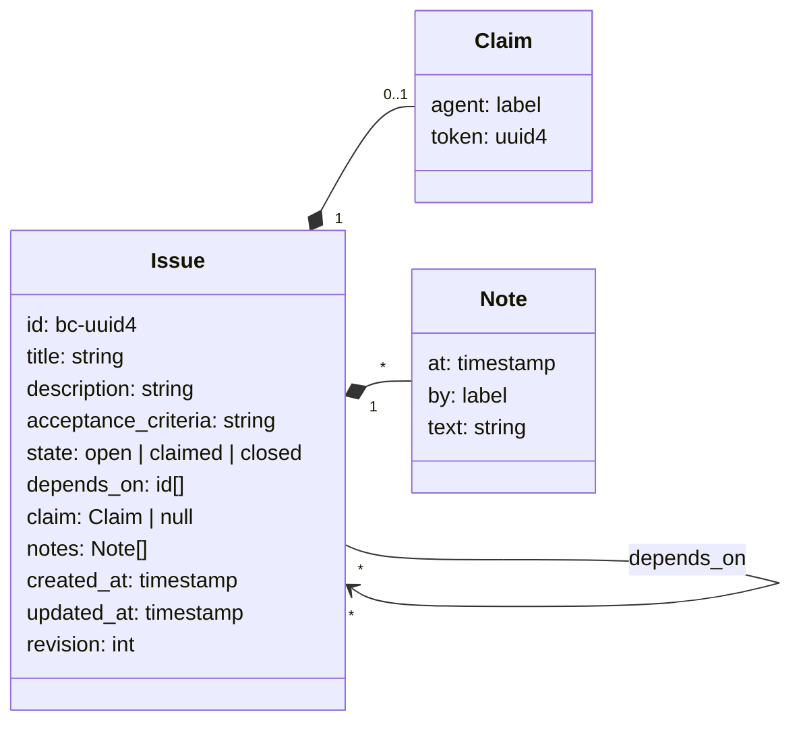

# On-disk protocol

Status is v1 draft 1 of the [core contract](core-contract.md). The first interoperable release will freeze the format and behavior together.

## Encoding and paths

- Records are UTF-8 JSON without a byte-order mark. Writers emit one object per file, formatted for human inspection, with a final LF. Readers accept any valid JSON whitespace and object member order.
- Reject duplicate object keys, invalid UTF-8, unpaired Unicode surrogates, and values or fields outside the definitions below. Match field names exactly. All listed fields are required and unknown fields are invalid.
- An issue ID is `bc-` followed by a lowercase UUIDv4 in compact form. Its full pattern is `^bc-[0-9a-f]{12}4[0-9a-f]{3}[89ab][0-9a-f]{15}$`. Generate IDs from the platform's random source. Under the store lock, retry generation if the target filename already exists.
- Store each issue at `.beadcrumbs/issues/<id>.json`. Its filename must match the record's ID. Every name ending in `.json` in the issue directory is an issue candidate and must be a regular file with a valid name and record. The scratch names in [Concurrency](concurrency.md) have no `.json` suffix.
- Timestamps are UTC strings in the form `YYYY-MM-DDTHH:MM:SSZ`, with valid Gregorian calendar values and seconds from `00` through `59`. Sample the clock once per successful mutation. Clocks can move backwards. Use the revision for ordering edits to one issue and the array order for ordering its notes.

## Manifest

Path is `.beadcrumbs/store.json`.

```json
{
  "format": "beadcrumbs",
  "version": 1
}
```

`format` must equal `beadcrumbs`. `version` is a JSON integer. Clients check the format and version before applying the version-specific field rules. A client that does not support the version reports an error without modifying the store or creating a lock.

## Issue record

```json
{
  "id": "bc-3a3d0744c20a4f35814eb2fc71629888",
  "title": "Document the offline setup",
  "description": "Document setup in a local directory with networking unavailable.",
  "acceptance_criteria": "A new worker can follow the instructions and run the lifecycle.",
  "state": "claimed",
  "depends_on": [],
  "claim": {
    "agent": "worker-01",
    "token": "57f9d4cfcc9f4f66a44e4f426334c66b"
  },
  "notes": [
    {
      "at": "2026-11-13T19:35:00Z",
      "by": "worker-01",
      "text": "Verified the workflow with networking disabled."
    }
  ],
  "created_at": "2026-11-13T19:30:00Z",
  "updated_at": "2026-11-13T19:35:00Z",
  "revision": 3
}
```



| Field | Type and rules |
| --- | --- |
| `id` | Issue ID. Immutable. |
| `title` | Nonempty string. Immutable in v1. |
| `description` | String, empty allowed. Immutable in v1. |
| `acceptance_criteria` | String, empty allowed. Immutable in v1. |
| `state` | One of `open`, `claimed`, or `closed`. Created as `open`. |
| `depends_on` | Array of distinct issue IDs. All targets must exist. The graph must be acyclic. Preserve array order. Immutable. |
| `claim` | For a claimed issue, an object containing exactly `agent` and `token`. The agent label matches `^[A-Za-z0-9][A-Za-z0-9._-]{0,63}$`. The token is a freshly generated lowercase compact UUIDv4, with the same syntax as an issue ID minus `bc-`. All other states use JSON `null`. |
| `notes` | Array of note objects in insertion order. Each contains exactly `at` (timestamp), `by` (agent label), and `text` (nonempty string). Empty at creation. |
| `created_at` | Timestamp. Immutable. |
| `updated_at` | Timestamp of the latest mutation. Equal to `created_at` at creation. |
| `revision` | JSON integer from 1 through 9007199254740991. Starts at 1 and increases by one for each mutation. Reject a mutation that would overflow. |

Nonempty strings contain at least one Unicode scalar value. Clients preserve content, including whitespace. Integer fields use decimal digits without a fraction or exponent. Booleans are invalid.

Claim changes `state` to `claimed` and sets `claim`. Release changes `state` to `open` and clears `claim`. Close changes `state` to `closed` and clears `claim`. A note appends one object using the mutation timestamp for `at`. Every mutation updates `updated_at` and increments `revision`. Preserve all other fields.

## Validation and compatibility

Under the lock, draft v1 clients load and validate all issue candidates and dependency references before any issue command. A missing dependency, cycle, malformed record, or unexpected file type at a protocol path invalidates the store. A claimed or closed issue must have all its dependencies closed. A missing issue requested by ID is a separate error. Creation only accepts dependencies on existing issues, which makes a cycle impossible through the CLI.

A ready issue is `open` with all direct dependencies `closed`. Sort the ready list by `created_at` ascending, then by issue ID ascending. Compare both as ASCII strings.

Changes to required fields, allowed fields, validation, or locking semantics require a protocol version increment after v1 freezes. A client's release version is independent of the store version. An older client encountering a newer format must leave it untouched.

Description and acceptance criteria are required on disk. Creation defaults omitted values to empty strings. Earlier unreleased draft records require the explicit conversion described in the [core contract](core-contract.md#compatibility). Text has no protocol-defined length cap. Resource failures must be reported without publishing a partial record.

## Store contents

For an initialized store, extra entries outside the manifest, issue candidates, and lock are ignored and preserved. Clients never traverse them. Every direct issues-directory entry ending in .json is a candidate regardless of name or type and must validate. Temporary files have the .tmp-<token> shape. Unknown entries in an uninitialized store remain subject to the stricter initialization rules.

Machine-readable structural schemas and their semantic limits are described in [Conformance](conformance.md).
